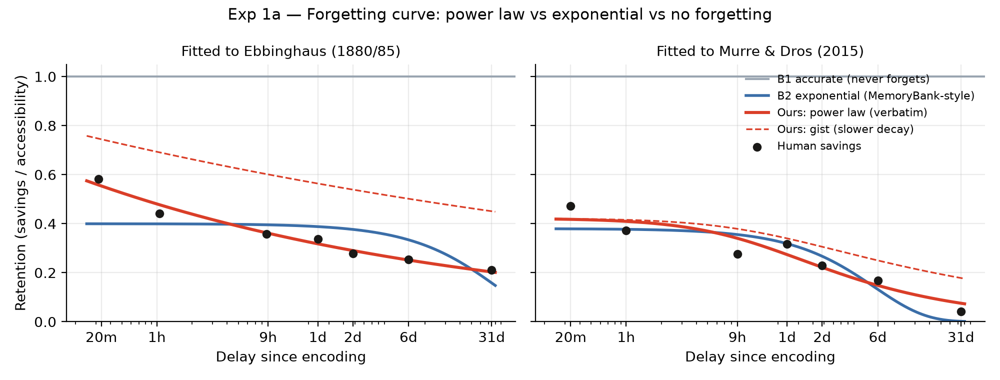
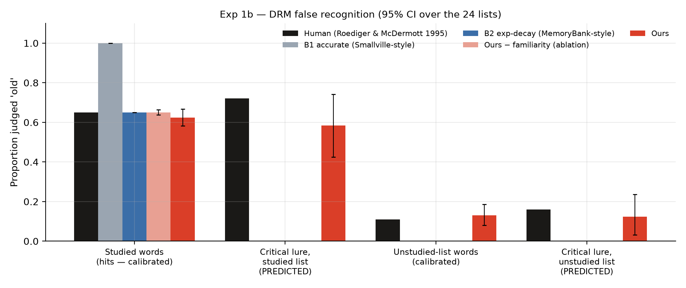
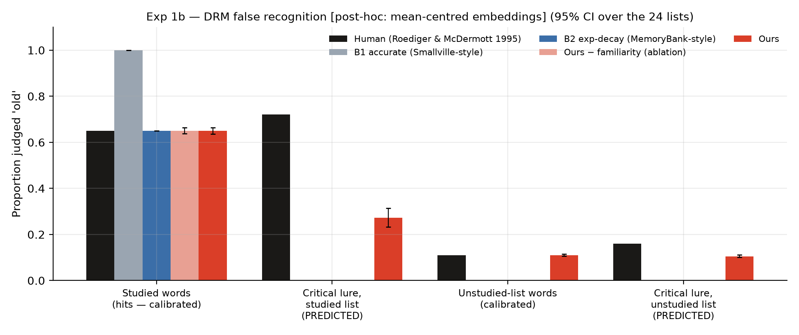
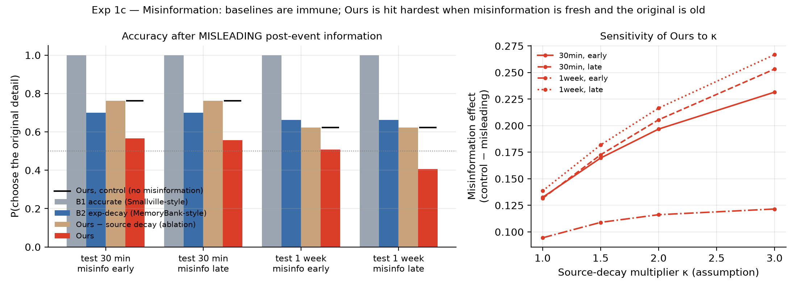
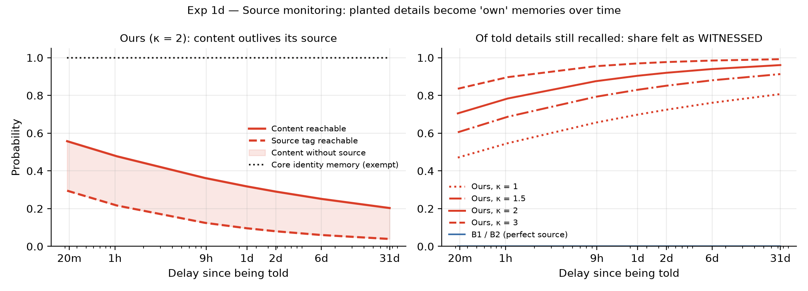

# Results, Explained — everything we have measured so far

**What this file is:** every result the research has produced, explained in plain language: what
the question was, what we did, what came out, what it means, and where it is weak. Read it top to
bottom once; after that, use it as the place you look things up before a viva, a meeting or a
paper section. New results get added here as they come in (see the last section).

- **Last updated:** 21 Oct 2026
- **Results so far:** Study 1 at the *memory level* (four experiments, 1a–1d)
- **Exact numbers with confidence intervals:** `research/results/study1/summary.md` (auto-generated,
  never hand-edited). **Figures:** `research/results/study1/*.png`.
- **To regenerate everything:** `cd research && .venv/bin/python experiments/run_study1.py`

---

## Part 0 — What you need before reading the results

### 0.1 The big picture in five lines
1. Normal AI-agent memory (like Smallville's) is **too good**: it never forgets and never gets
   anything wrong. Real people forget, blend things together, and forget *where* they heard
   something.
2. We built a memory layer that makes those human mistakes on purpose, using well-known models
   from memory psychology.
3. We then ran four classic human-memory experiments **on the memory layer** and compared its
   numbers with the published human numbers from those same experiments.
4. We ran the *same* experiments on two standard agent memories (the baselines) and on versions of
   our model with one mechanism switched off (the ablations).
5. If our model behaves like people and the others don't, and each human-like error disappears
   when we switch off the mechanism that causes it, the memory layer does what we say it does.

### 0.2 Important: no LLM was used yet
These experiments test the **memory layer alone**. For each memory it computes a probability, such
as "the chance this memory can still be reached after 9 hours". Nothing was typed into a language
model. That makes the results exact and repeatable (same input → same numbers) and free to run.
The next step (Part 6) runs the same tests *through* an LLM (Qwen2.5-7B on Ollama), to check that
the character's actual answers follow what the memory layer decides.

### 0.3 The contestants
| Name in the results | What it is | Real-world equivalent |
|---|---|---|
| **B1 accurate** | Remembers everything perfectly, forever | Smallville / Generative Agents style memory (retrieval only, nothing ever fades) |
| **B2 exp-decay** | Memories fade with an exponential curve, but what is remembered is always correct and its source is always known | MemoryBank-style forgetting |
| **Ours** | Power-law fading, slower fading of the gist than the details, familiarity-based recognition, a source tag that fades faster than the content, rehearsal, core identity protected | Our memory layer |
| **Ours − familiarity** | Ours with the familiarity mechanism switched off | Ablation for Exp 1b |
| **Ours − source decay** | Ours with the source tag never fading | Ablation for Exp 1c |

### 0.4 Words that appear everywhere
- **Accessibility / p:** the probability that a memory can be reached right now. A memory is
  **never deleted** in our model; it just becomes harder to reach (as in people: something you
  "forgot" can come back with the right cue).
- **Calibrated vs predicted.** *Calibrated* = we tuned the model's settings so this number matches
  the human number; matching it proves nothing. *Predicted* = we never tuned for it; whatever comes
  out is a genuine test. In the tables, the interesting columns are always the predicted ones.
- **Held-out test:** fit the model to one dataset, then test it on a *different* dataset without
  refitting. It checks that the model learned the pattern rather than memorising the points.
- **R² (R-squared):** how much of the pattern in the human data the curve explains. 1 = perfect,
  0 = no better than a flat line.
- **RMSE:** the typical size of the error between the model and the human points. Lower is better.
- **AICc:** a score for comparing models that **penalises extra parameters**, so a model can't win
  just by having more knobs. Lower is better; a difference of more than ~10 is decisive.
- **95% CI [a, b]:** confidence interval. We re-ran the analysis on 4,000 random re-samples of the
  24 DRM word lists (bootstrap); the true value very likely lies between a and b. A wide interval
  means the result varies a lot from list to list.
- **Ablation:** switching one mechanism off to show that it causes an effect.
- **Pre-registered:** we wrote down how the test would be scored *before* seeing the result, so we
  couldn't quietly tune it until it looked good.
- **Demonstration (vs calibration):** the experiment shows the mechanism behaves in the right
  direction, but one of its settings is an assumption rather than something fitted to human data.

---

## Part 1 — Exp 1a: Does the agent forget at the same rate as a person?

### The question
Human forgetting is fast at first and then slows down a lot; you lose much of a list within an
hour, but what is left after a day is still mostly there a month later. Which mathematical curve
describes this best: a **power law** (ours) or an **exponential** (what MemoryBank-style agent
memories use)?

### The human data
- **Ebbinghaus (1880/1885):** he learned lists of nonsense syllables and measured how much easier
  it was to relearn them after 20 min, 1 h, 9 h, 1 day, 2 days, 6 days and 31 days ("savings").
  Values: 58.2, 44.2, 35.8, 33.7, 27.8, 25.4, 21.1%. We took these from Murre & Dros (2015), Table 3.
- **Murre & Dros (2015):** a modern replication of the same experiment. We use it as the
  **held-out** test.

### What we did
We fitted each model's curve to the Ebbinghaus points, then used those same settings to predict
the Murre & Dros points without refitting. We also did the reverse (fit Murre & Dros, predict
Ebbinghaus).

### What came out
| Model | R² (fit) | RMSE (fit) | AICc | Error predicting the other dataset |
|---|---|---|---|---|
| **Ours — power law** | **.974** | **.019** | **−41.7** | **.094** (reverse: .096) |
| B2 — exponential | .397 | .091 | −26.6 | .112 (reverse: .122) |
| B1 — no forgetting | — | .659 | — | .743 |

### What it means
- The power law explains 97% of Ebbinghaus's curve; the exponential explains about 40%. The AICc
  gap (15 points) is decisive even though the power law has one more parameter.
- It also predicts a *different* dataset better, in both directions. So it captures the shape of
  human forgetting rather than just fitting seven points.
- **How to read the figure:** dots are human data. In the left panel the blue exponential is flat
  for a week and then crashes, because one exponential has a single timescale and can't be both
  fast early and slow late. The red power law follows the dots. The dashed red line is the *gist*,
  which fades more slowly than the exact details (people remember "it was about a red dress" long
  after "crimson silk with a lace collar"). B1 is the flat grey line at 1.0: it never forgets.

### Weak points (say these before someone else does)
- **Savings are not recall.** Ebbinghaus measured how much faster relearning was, not how much he
  could recall. We use his curve for its *shape*, which is standard practice, not as a recall rate.
- **One parameter hit its limit.** `a` (the starting level) went to its maximum of 1.0 and the time
  constant τ is about 13 seconds, so the fitted curve is effectively a pure power law. That's fine
  for the claim but worth knowing if someone asks about the parameters.
- The two human curves differ from each other (one person in 1880 vs a replication), which is why
  the held-out errors (~.09) are bigger than the fit errors (~.02).

### One-line takeaway
*Human forgetting follows a power law; our memory layer uses one and matches both the original and
a replication better than the exponential decay used in existing agent memories.*

---

## Part 2 — Exp 1b: Does the agent "remember" a word it never saw? (DRM)

### The question
The **DRM paradigm** (Deese 1959; Roediger & McDermott 1995) is the most famous false-memory
experiment. People hear a list such as

> bed, rest, awake, tired, dream, wake, snooze, blanket, doze, slumber, snore, nap, peace, yawn, drowsy

and later most of them are sure they heard **"sleep"**, which was never on the list. "Sleep" is the
**critical lure**. Does our agent fall for the lure the way people do?

### The human data (Roediger & McDermott 1995, Experiment 2; checked against the paper)
| Item type at test | Proportion called "old" by people |
|---|---|
| Studied words (real list words) | .65 |
| **Critical lure of a list they heard** (e.g. "sleep") | **.72**, higher than the real words! |
| Words from lists they didn't hear | .11 |
| Critical lure of a list they didn't hear | .16 |

People also said whether they **"remember"** hearing it (a vivid recollection) or just **"know"**
it was there (a feeling of familiarity). For the lures it was .38 remember / .34 know: people
vividly "remembered" hearing a word that was never said.

### How our model can call something "old" (the mechanism)
We use a standard two-route model of recognition (dual-process; Yonelinas 2002):
1. **Recollection:** the agent actually reaches the stored memory of that word (only possible for
   words that were really studied, and it fades with time as in Exp 1a).
2. **Familiarity:** the word *feels* known because it resembles many stored memories at once. We
   compute it with MINERVA 2 global matching (Hintzman 1988): add up the word's similarity to every
   stored memory (similarity from the embedding model; cubed, so only close matches count much).
   If that total is above a threshold (with some noise), the word feels old.

"Sleep" is close in meaning to all 15 list words, so its familiarity is high even though it was
never stored. **That is the whole mechanism; nothing about lures is hand-coded.** B1 and B2 only
have route 1 (look the word up: there or not there), so they can't fall for a lure.

### What we did (the pre-registered protocol)
- Same design as the human study: 24 lists, 16 heard per participant, 3 counterbalanced groups.
- We **calibrated** only on the real-word numbers: remember .41, know .24, unrelated words .11.
- The **lure rates were never used for tuning**. They are the predictions.

### What came out (primary run)
| | Studied | **Lure, studied list** | Unrelated | **Lure, unstudied list** |
|---|---|---|---|---|
| Human | .65 | **.72** | .11 | **.16** |
| **Ours** | .62 | **.59** [.43, .74] | .13 | **.12** [.03, .24] |
| Ours − familiarity | .65 | 0 | 0 | 0 |
| B2 exp-decay | .65 | 0 | 0 | 0 |
| B1 accurate | 1.00 | 0 | 0 | 0 |

Extra evidence that the mechanism is the right one: lists whose lure is more similar in meaning to
the list words produce more false alarms (Spearman ρ = .69, p = .0002). That matches the human
finding that some lists ("sleep", "chair") are much stronger than others.

### What it means
- **Only our model has the false memory at all.** Every baseline is at exactly 0, and so is our own
  model with familiarity switched off. So familiarity is what produces it (that's the ablation).
- The predicted lure rate (.59) is in the right region but **below the human .72**: the human value
  is inside the wide confidence interval, but our average is lower.

### The complication you must understand: the post-hoc run

In the primary run the calibration **could not hit all three targets at once**. The best possible
"know" rate was .20 (target .24). The reason is a known property of embedding models called
**anisotropy** (Ethayarajh 2019): all sentence-embedding vectors point roughly the same way, so even
unrelated words look somewhat similar (cosine ~0.2–0.3 instead of ~0). That squashes the gap between
"related" and "unrelated", so the model can't tell them apart as cleanly as people do.

The standard fix is **mean-centring**: subtract the average vector so that unrelated words really
look unrelated. We ran that as a second analysis and **labelled it post-hoc**, because we decided
it after seeing the first result.

| | Studied | **Lure, studied list** | Unrelated | **Lure, unstudied list** |
|---|---|---|---|---|
| Human | .65 | **.72** | .11 | **.16** |
| Ours, mean-centred (post-hoc) | .65 | **.27** [.23, .31] | .11 | **.11** |

Now the calibration is exact, but the lure rate drops to .27, and the similarity effect is even
stronger (ρ = .92).

**How to say this honestly:** the false-memory effect appears only in our model, reliably, under
both versions of the embeddings; its **size depends on the embedding geometry (.27–.59)** and is
below the human .72 in both. This is a real limitation and a clear item for future work (a better or
domain-tuned embedding model).

### Second limitation: no "phantom recollection"
All our lure false alarms are "know" (familiarity), none are "remember", because our recollection
route only works for things really stored. People report vividly "remembering" the lure (.38). Our
model reproduces *that* the lure feels familiar, not the vivid false experience. A future
mechanism would let gist activation feed recollection (fuzzy-trace theory explains phantom
recollection this way).

### One-line takeaway
*A false memory for a never-presented word emerges from similarity alone, only in our model and in
none of the baselines, though at a lower rate than in people and with a size that depends on the
embedding model.*

---

## Part 3 — Exp 1c: Can a detective plant a wrong detail? (Misinformation)

### The question
In Loftus's misinformation studies (Loftus, Miller & Burns 1978) people saw a car stop at a
**STOP** sign. Later, a question mentioned a **YIELD** sign. On a two-choice test (stop or yield?)
many then picked yield. It matters most **when the original memory is old and the misleading
information is fresh**. This is exactly what an interrogating detective does with leading questions.

### What we did
- t = 0: the agent witnesses "the car stopped at a STOP sign".
- Later: one of three things happens. **Control** (nothing), **consistent** (the stop sign is
  mentioned again, which acts as a rehearsal), or **misleading** (the detective says "yield sign",
  stored as a memory with source = *told by detective*).
- Test: "stop or yield?" Four timing cells: test after **30 min** or **1 week**, with the misleading
  information either **early** (6 min after the event) or **late** (6 min before the test).

### How the agent chooses (the mechanism, in words)
- If it can reach the original and the rival is not usable, it picks the original.
- The rival ("yield") is **usable** only if it can be reached **and its source tag has faded**. If
  the agent still remembers "the detective told me that", it discounts it, as people do when they
  remember the source.
- If both are usable, it picks between them in proportion to how strong each is (Luce's choice rule).
- If it can reach neither, it guesses 50/50.

### What came out (Ours with κ = 2; control in brackets)
| Timing | B1 | B2 | Ours − source decay | **Ours** |
|---|---|---|---|---|
| 30 min, early | 1.00 (1.00) | .70 (.70) | .76 (.76) | **.57** (.76) |
| 30 min, late | 1.00 (1.00) | .70 (.70) | .76 (.76) | **.56** (.76) |
| 1 week, early | 1.00 (1.00) | .66 (.66) | .62 (.62) | **.51** (.62) |
| 1 week, late | 1.00 (1.00) | .66 (.66) | .62 (.62) | **.41** (.62) |

The number to look at is the **drop from control to misleading** (the misinformation effect):
.20, .21, .12 and **.22** for Ours. It is 0 for everyone else.

### What it means
- **Baselines are immune.** B1 never forgets. B2 forgets (that's why its control is .70, not 1.0:
  sometimes it has lost the memory and guesses) but it always knows the yield sign came from the
  detective, so it is never misled. "Ours − source decay" is immune for the same reason. So the
  fading source tag is what makes misinformation work (the ablation again).
- **The timing pattern matches people for the 1-week cells:** misinformation hurts most when it
  arrives late in a long interval (.22) and least when it arrives early (.12), because by the test
  an early rival has faded too. At 30 minutes, timing barely matters in our model.
- In the **consistent** condition (stop sign repeated) accuracy goes *up* (.89 at 30 min), because
  hearing it again is a rehearsal.

### Weak points
- **κ is an assumption.** κ is how many times faster the source tag fades than the content. There is
  no human data we have fitted it to, so we show κ = 1, 1.5, 2, 3 (right panel). The effect is
  present at every value and grows with κ; the *pattern* (1-week-late hurts most, 1-week-early
  least) holds at every κ.
- The human figure for this paradigm (75% correct after consistent vs 41% after misleading) is from
  a **secondary source**; we haven't extracted it from the original paper yet. So this experiment is
  labelled a **demonstration**, and we compare with the human *pattern*, not the exact numbers.
- Because the fitted τ is tiny (~13 s), a source tag is already noticeably faded 6 minutes after
  being told. That's inherited from Exp 1a's fit and makes the 30-min cells look similar.

### One-line takeaway
*A misleading detail from the interrogator replaces the witnessed one only in our model, most
strongly when the original is old and the misinformation fresh, which is the human pattern; standard
agent memories cannot be misled at all.*

---

## Part 4 — Exp 1d: "Did you see it, or were you told?" (Source monitoring)

### The question
People often remember a fact but forget where they got it, and then assume they saw it themselves
(source-monitoring errors; Johnson, Hashtroudi & Lindsay 1993). For our game this is the key
mechanism: the detective says "the woman on the landing wore a red dress"; a week later the suspect
says *"I saw a woman in a red dress"*, and that's an **honest false memory**, not a lie.

### What we did
The agent is told the red-dress detail (source = detective) and also has a core identity memory
("My name is Thomas Bell; I am the valet"). We measured, at the Ebbinghaus delays:
- can the content still be reached?
- can the source tag still be reached?
- **of the told details still remembered, what share now feels witnessed?** This is the
  source-amnesia index = 1 − P(source reachable).

### What came out
Share of still-remembered told details that feel *witnessed*:

| κ | 20 min | 1 h | 9 h | 1 day | 2 days | 6 days | 31 days |
|---|---|---|---|---|---|---|---|
| 1 | .47 | .55 | .66 | .70 | .72 | .76 | .81 |
| 1.5 | .61 | .69 | .79 | .83 | .85 | .88 | .91 |
| **2** | **.71** | **.78** | **.88** | **.90** | **.92** | **.94** | **.96** |
| 3 | .84 | .90 | .96 | .97 | .98 | .99 | .99 |
| B1 / B2 | 0 | 0 | 0 | 0 | 0 | 0 | 0 |

The core identity memory stays at 1.0 throughout (dotted line, left panel).

### What it means
- **Left panel:** the content (solid) outlives its source (dashed). The shaded gap is "I remember it
  but not where from", the zone where honest false memories live.
- **Right panel:** as time passes, almost everything the detective planted that the suspect still
  remembers comes back as *"I saw it"*. B1 and B2 never do this.
- **Core identity never moves.** The character always knows who they are while the edges of their
  memory drift. We call this **selective fallibility**: the persistent self stays put while
  episodic details fade.

### A correction we made (good to know)
The first version reported the *joint* chance "the detail is remembered AND feels witnessed". That
number **falls** over time (from .39 to .20 at κ = 2), which looks backwards, but it falls only
because the detail itself is being forgotten. The meaningful measure is the conditional one above,
which rises. Both are in `summary.md`; the correction is logged in `PROJECT_CONTEXT.md` §9.

### Weak points
- Same κ assumption as Exp 1c, so this is a **demonstration**, shown as a sweep.
- No human source-monitoring data has been extracted yet, so there is no human line on this figure.
- Core identity being exempt is a design decision, not a finding. The finding is that the rest
  degrades while it doesn't.

### One-line takeaway
*Details the character was told gradually turn into things it believes it witnessed, while its core
identity never changes, which is the lie-vs-honest-mistake ambiguity the game is built on.*

---

## Part 5 — What we can and cannot claim right now

### We can say
1. Standard agent memories are **superhuman** (B1: never forgets, never wrong) or **forget without
   ever being wrong** (B2).
2. Our memory layer reproduces the **types** of human memory error, in the **right direction** and
   with the right **shape**: power-law forgetting, DRM false recognition, misinformation with the
   human timing pattern, and source misattribution growing with time.
3. Each error type **disappears when its mechanism is switched off** (ablations), so we know which
   mechanism causes which error.
4. Core identity stays stable while episodic memory degrades (selective fallibility).

**Paste-ready sentence (draft paper):**
> At the memory level, the composed layer reproduced four signature phenomena of human memory that
> standard agent memories cannot produce: power-law forgetting (R² = .974 on Ebbinghaus; better
> held-out prediction of a modern replication than exponential decay), DRM false recognition
> emerging from semantic similarity alone (predicted lure false-alarm rate .59 vs human .72; .27
> under mean-centred embeddings), time-dependent misinformation effects, and growing source
> misattribution, with each phenomenon eliminated by ablating its mechanism.

### We cannot say (yet)
- That it matches human **magnitudes** exactly. The DRM rate is low, and 1c/1d rest on κ.
- Anything about what the **LLM character actually says**. That's the next run.
- Anything about **players** (more fun, more believable, harder). That needs the game study.
- That any of the mechanisms is **new**. They come from the psychology literature; our
  contribution is combining them for fidelity in a persistent character and evaluating that
  (see `PROJECT_CONTEXT.md` §6.3).

---

## Part 6 — Parameter cheat-sheet

| Symbol | Meaning | Value used | Where it came from |
|---|---|---|---|
| a | Starting accessibility | 1.0 | Fitted, Exp 1a (hit its upper bound) |
| τ (tau) | How soon forgetting kicks in | 0.0036 h (~13 s) | Fitted, Exp 1a |
| d | Forgetting rate (power-law exponent) | 0.130 | Fitted, Exp 1a |
| gist_ratio | Gist decays at this fraction of the detail rate | 0.5 | Assumption (fuzzy-trace theory: gist fades slower) |
| ρ (rho) | Boost per rehearsal | 0.5 | Assumption |
| κ (kappa) | Source tag fades κ× faster than content | 2 (swept 1–3) | **Assumption**, always shown as a sweep |
| k | Familiarity sharpness (similarity cubed) | 3 | Standard MINERVA 2 value |
| a_word, criterion, noise | DRM word strength, familiarity threshold, noise | .751, 4.11, .284 | Calibrated on R&M real-word data only |

---

## Part 7 — Questions you might get, with answers

**"You tuned it until it matched."**
For DRM we tuned only on real-word responses; lure rates were never used and are predictions. For
forgetting we tested on a second dataset without refitting. Anything decided after seeing results
(mean-centring) is labelled post-hoc.

**"Your false-memory rate is lower than humans'."**
Yes, .59 (or .27 with centred embeddings) vs .72. The point is that it exists only in our model and
is predicted by semantic similarity; the magnitude depends on the embedding model, which we report
as a limitation.

**"Why not just prompt the LLM to 'act like it has bad memory'?"**
That's baseline B3, coming in the LLM runs. Prompting gives no control over *which* memories go
wrong, *when*, or *how much*, and no persistence over days. Our layer decides that explicitly and
logs it, which is also what lets the game separate an honest mistake from a lie.

**"Why a power law?"**
Because human forgetting data fits it (Wixted & Ebbesen 1991), and our Exp 1a shows it fits and
predicts better than the exponential that agent memories commonly use.

**"Is the LLM even involved?"**
Not in these results. They test the memory layer. The LLM is only the character's voice; it gets
the memories the layer allows it to reach. The next study checks that the voice follows them.

**"What is κ and why should we trust it?"**
It's how much faster the source fades than the content. We don't claim a value; we show results
for 1 to 3, and the qualitative pattern holds across all of them.

---

## Part 7.5 — First LLM result: does the suspect's *voice* follow the memory layer?

*Full numbers and real transcripts: `research/results/study_llm/llm_source_fidelity.md`.*

### The question
Everything above tested the memory layer's probabilities. This tests the **pipeline**: the layer
decides what the suspect can recall and whether a detail the detective planted ("a woman in a red
dress on the landing") still carries its "the detective told me" tag; the LLM (qwen2.5-coder:3b, run
locally on Ollama — the model already on the machine) is only the **voice**. Does the voice say what
the layer decided?

### What we did
Thomas Bell has five seed memories (his identity, three things he witnessed, and the planted
red-dress detail). At three simulated delays (3 h, 3 days, 1 week), the layer samples what he can
recall, we build his prompt from only that, and he answers the detective in JSON. 12 runs per cell.
Compared against **B0** (perfect witness: full, correctly-sourced memory) and **B3** ("you have
ordinary human memory", but no actual memory layer).

### What came out
- **The core signal works:** when the layer drops the source tag (frames the detail as *witnessed*),
  the suspect says he **saw** her first-hand in **0.54** of runs and **never** credits the detective.
  When the layer keeps the tag, he doesn't claim first-hand. So the voice tracks the layer.
- The honest-false-memory rate rises then falls with delay (0.25 → 0.42 → 0.33): by a week he has
  often forgotten her entirely, and **you can't misattribute what you no longer recall** — the same
  point as Exp 1d.
- B3 ("act human") is erratic and mostly just hedges ("unsure" ~0.8); it has no time course.

### The honest weak points (these are real and in the paper)
- **The 3B model is noisy.** The perfect-witness baseline B0 *itself* said "I saw her" in **0.33** of
  runs even though it was handed a correctly-sourced memory — a small model blurs "told" into "saw".
  That noise partly masks the ours-vs-B0 gap in the headline numbers.
- **It confabulates.** When the layer had completely forgotten the woman, the model still invented her
  in **0.24** of runs (one run even had her pull a gun). We forbid invented facts in the prompt; a 3B
  model doesn't always obey.
- **The source tag fades almost instantly** here, because the τ fitted to Ebbinghaus is ~13 seconds.
  So by the morning after, the "told" framing almost never survives (it came up in only 2 of our
  runs). In the real game we'd use a slower, game-clock τ so the tag can linger for a scene or two.

### What this does and doesn't show
It shows the **pipeline is real**: the memory layer can drive an LLM character's source attribution,
and the honest-false-memory behaviour appears end-to-end. It does **not** yet show a polished,
calibrated character — that needs a bigger/instruction-tuned voice model, a separate LLM judge to
label stances (instead of the model self-reporting), a game-appropriate time constant, and the
cross-model check with gemma3:1b. So this is labelled a **proof-of-concept**; the calibrated claims
all live at the memory level (Parts 1–4).

### One-line takeaway
*The memory layer can steer what an LLM suspect claims to have witnessed — the honest false memory
shows up in the suspect's actual words — but a 3B voice adds source confusion and confabulation, so
this is a working proof-of-concept, not yet a calibrated character.*

---

## Part 8 — Next results (to be added here)

| Study | Question | Status |
|---|---|---|
| Study 1, LLM level (voice follows layer) | Does the suspect's answer follow the layer's source decisions? B0/B3 baselines | ✅ preliminary (Part 7.5) |
| Study 2 | Over 100+ turns and simulated days: does core identity stay consistent while episodic details drift? | 🔜 |
| Study 3a | AI detective vs suspects at different fallibility levels: how do solve rate and contamination change? | 🔜 |
| Study 3b | Player pilot (12–24 people), memory ON vs OFF | Later |

The paper draft (IEEE format) collecting all of this is in `paper/ravenswood.tex`.

## Sources for the human data
- Ebbinghaus, H. (1885). *Über das Gedächtnis.* Values via Murre, J. M. J., & Dros, J. (2015).
  Replication and analysis of Ebbinghaus' forgetting curve. *PLOS ONE*, 10(7), e0120644 (Table 3).
- Roediger, H. L., & McDermott, K. B. (1995). Creating false memories: Remembering words not
  presented in lists. *JEP: Learning, Memory, and Cognition*, 21(4), 803–814. (Exp 2 values and the
  24 word lists.)
- Loftus, E. F., Miller, D. G., & Burns, H. J. (1978). Semantic integration of verbal information
  into a visual memory. *JEP: Human Learning and Memory*, 4(1), 19–31. (Pattern only; figures
  secondary-source.)
- Johnson, M. K., Hashtroudi, S., & Lindsay, D. S. (1993). Source monitoring. *Psychological
  Bulletin*, 114(1), 3–28.
- Models: Hintzman (1988) MINERVA 2; Yonelinas (2002) dual-process recognition; Luce (1959) choice
  rule; Wixted & Ebbesen (1991) form of forgetting; Ethayarajh (2019) embedding anisotropy.
  Check exact citation details before the paper (`PROJECT_CONTEXT.md` §10).
